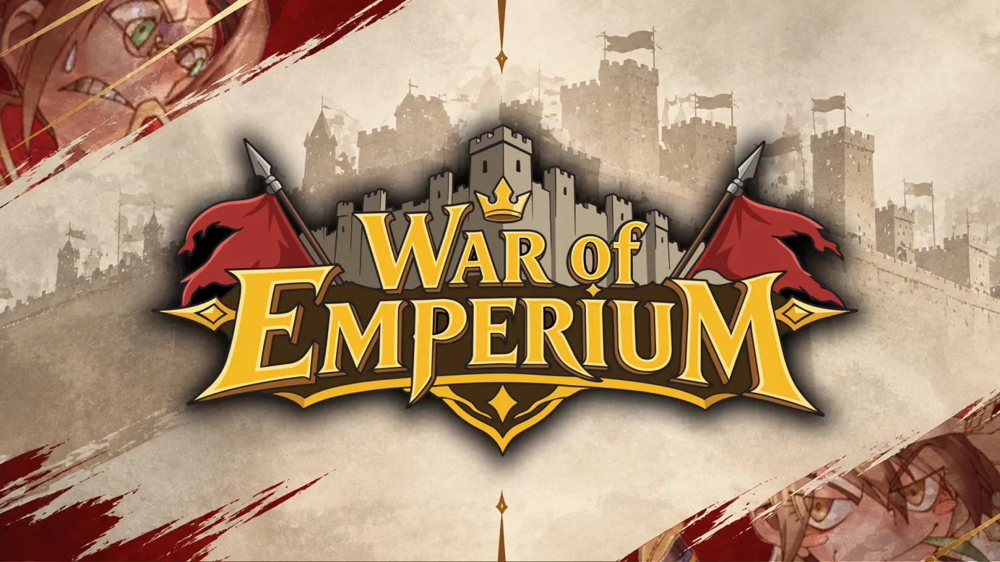

# [Siege Notice] War of Emperium EU Schedule Adjustment – Daylight Saving Time

- kind: official
- channel: announcement
- posted: 23 ต.ค. 2569 15:51 น.
- message: 1563112622721863720

||@everyone||

Adventurers,

We would like to inform all adventurers on the Skadi (EU) server of an upcoming adjustment to the War of Emperium (WoE) schedule.

In consideration of the Daylight Saving Time (DST) change in Europe, the War of Emperium schedule for the EU server will be moved 1 hour later to better accommodate our European adventurers.

This adjustment will take effect following the scheduled maintenance on October 29, 2026.

⚔️ Updated War of Emperium Schedule

Server: Skadi (EU)

Previous Time: 19:00 – 20:00 (UTC+0)

New Time: 20:00 – 21:00 (UTC+0)

Days: Every Wednesday & Sunday

Effective Date: October 29, 2026 (After Maintenance)

📌 Important Notes

This adjustment applies only to the Skadi (EU) server.

The SEA servers (Odin & Loki) will continue following their existing WoE schedule of 14:00 – 15:00 (UTC+0).

All other War of Emperium rules and mechanics remain unchanged.

The updated schedule will apply starting from the first War of Emperium session following the October 29 maintenance.

We encourage all participating guilds to take note of the updated schedule and coordinate with their guildmates accordingly.

Thank you for your understanding, and we look forward to seeing you on the battlefield!

See you in Midgard, Adventurers!

