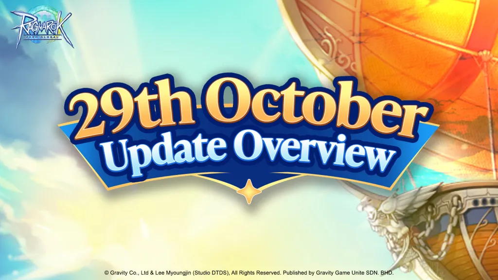

# [Update Notice] New Mysteries, Legendary Heroes – October 29 Update!

- kind: official
- channel: announcement
- posted: 29 ต.ค. 2569 12:42 น.
- message: 1565239336419467274

||@everyone||

Adventurers,

The hands of time are turning, and a brand-new adventure awaits in Ragnarok Zero: Global!

The October 29 Update brings exciting new challenges, mysterious discoveries, and legendary heroes to Midgard!

From exploring the eerie depths of the newly opened Clock Tower Dungeon to welcoming the legendary Science Ninja Team Gatchaman in an exciting collaboration event, there's plenty to discover!

🌟 What's New?

🕰️ Clock Tower Dungeon Opens!
⚔️ New Daily Quests & Event Story
⚙️ New Equipment & Clock Tower Gear Upgrades
🦅 Science Ninja Team Gatchaman Collaboration
✨ And More!

Whether you're seeking new challenges, powerful equipment, or a fresh new look, there's something for every adventurer in this update!

📖 Want to know more about the latest update?

Click the link below to check out the October 29 Update Overview for a closer look at all the new content and features!

🔗 Update Overview:https://roz.mygnjoy.com/en/news/update/175

The clock is ticking, Adventurers. Your next adventure begins now!

Play Now:https://roz.mygnjoy.com/en/

Join our official Discord server:https://discord.com/invite/bFg77WjcHT

Follow & Share Our Social Media:
FB:https://www.facebook.com/ragnarokzeroglobal/
IG:https://www.instagram.com/ragnarokzeroglobal/
TikTok:https://www.tiktok.com/@ragnarokzeroglobal
Youtube:https://www.youtube.com/@RagnarokZeroGlobal

#ragnarokzeroglobal #Ragnarok #roz #MMORPG #gravitygameunite

